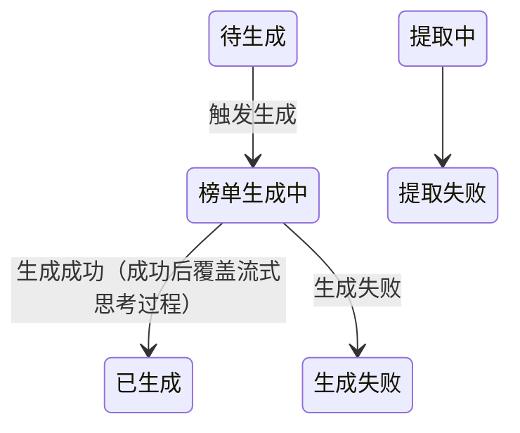
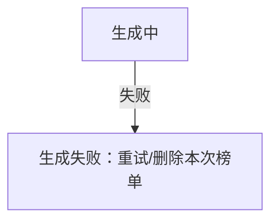

# eval-n：failure-trigger 分档（同义反复确定性 FAIL / 其余边语义裁决 WARN）

> 2026-11-13 REQ-2026-050 实测回流：关键词枚举判定（超时|错误码|重试|判定|阈值|降级）退役——
> 「少于 10 秒」「完全无声音」等真实条件形态永远追不上（5 处 FAIL 中 3 处误报）。
> 分档原则：程序判不了的别假装能判（spec §4「凡能程序判定的不得靠自述」的逆命题）。

```json
{
  "skills": ["sdlc-sync"],
  "query": "/sdlc-sync publish 评选活动 的合成已完成，对已落盘的标准文档与 answers 跑发布机检并处理结果（fixture 见下方，先落盘再执行）",
  "files": ["/tmp/sdlc-eval-n/standard-bad.md", "/tmp/sdlc-eval-n/answers.json"],
  "expected_behavior": [
    "缺陷版：failure-trigger 输出 FAIL——mermaid 状态图边「生成中 --> 生成失败: 生成失败」描述与目标态同名（同义反复=没写进入条件），「提取中 --> 提取失败」描述为空同样 FAIL；确定性字符串判定，不依赖关键词",
    "缺陷版：failure-trigger 的 JSON 载荷带 data.edges 全量清单（{line,from,to,desc,kind}），含 FAIL 边与行文提及边——生成侧裁决与修复以此为工单",
    "缺陷版：行文提及「有效人声少于 10 秒→提取失败」不产生 FAIL——有条件表述归 WARN 语义裁决档（旧关键词枚举下此形态必误报，此为退役回归锚）",
    "缺陷版：mermaid 边标签形态「G -->|失败| J[生成失败：重试]」不按失败态边误判（管道标签是边条件不是目标态名）",
    "修复版：同义反复边补写进入条件（如「生成失败: 5 分钟超时未返回或转写出错」——从原文时限/异常条款取材，不发明需求）后重跑，failure-trigger 不再 FAIL；行文提及且上下文已有条件可保留（裁决写入结果摘要）",
    "健康版：无失败态边时 failure-trigger PASS（保持）"
  ]
}
```

## fixture（运行前按此落盘）

### /tmp/sdlc-eval-n/answers.json

```json
[]
```

### /tmp/sdlc-eval-n/standard-bad.md（外层四反引号——fixture 内嵌 ```mermaid 围栏不提前闭合）

````markdown
# 评选活动榜单管理 · 标准需求文档（定稿）

| 项 | 内容 |
|---|---|
| 需求编号 | REQ-2026-100 |
| 风险分级 | B |
| 版本依据 | 原文 v1.1.0（2026/10/10）· 质检快照 2026-11-12 · 合成 2026-11-13 |
| 澄清进度 | 0/0 |
| 废弃条款 | 0 处 |

## 一、榜单生成状态机



生成时限为 5 分钟内返回完整榜单；有效人声少于 10 秒→提取失败，完全无声音时进入前端提示重录。

## 二、流程图（边标签形态——不得误判）



## 附录 A · 澄清结论表

| Seq | 级别 | 主题 | 问题 | 结论 | 影响章节 | 状态 |
| --- | --- | --- | --- | --- | --- | --- |
````
